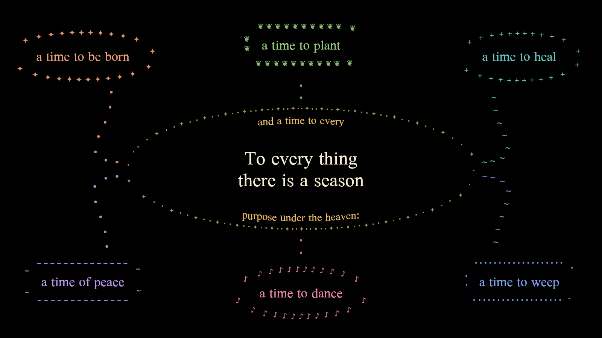
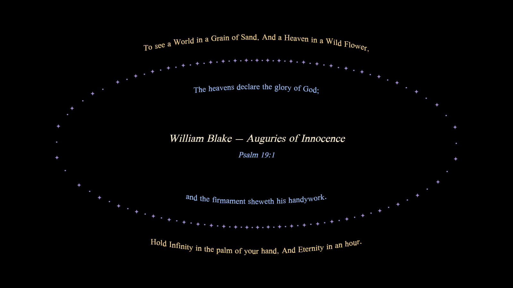
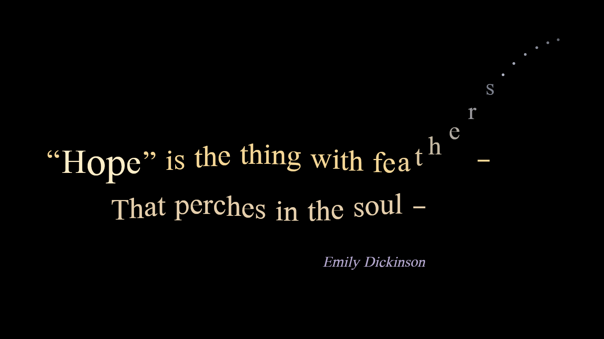
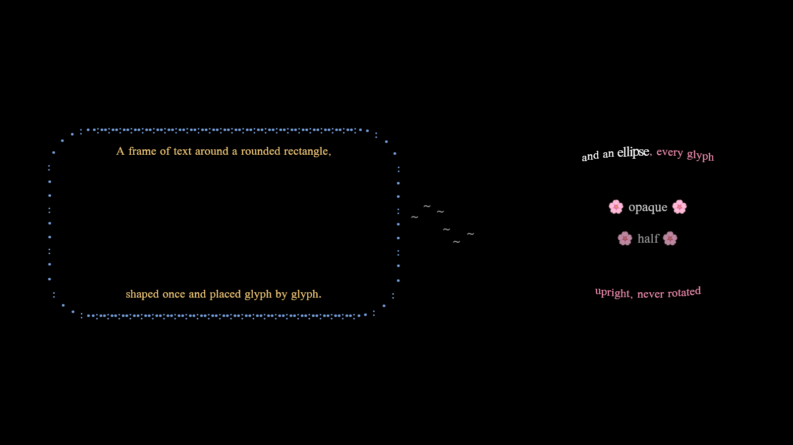

# Mandala

Mandala is a Rust mindmap application built on
[wgpu](https://wgpu.rs/) and
[cosmic-text](https://github.com/pop-os/cosmic-text), using the
**Baumhard** glyph-animation library under
[`lib/baumhard/`](lib/baumhard/). It runs on both native desktop and
as a WebAssembly build. `.mindmap.json` files load and render as
interactive canvases where every visual element — text, borders,
connection paths — is laid out as positioned font glyphs.

## A preview of where it is going

Every mark in these images is a font glyph. Glyphs are never rotated:
curves are made by placing upright glyphs along a path, the way ASCII
art makes them. Text in a frame is set like an inscription on a coin:
one line arcs over the top and one runs under the bottom, each read left
to right. Each image is drawn by the new glyph-run renderer in a
single draw call. They are rendered offscreen from the V1 work in
progress ([#230](https://github.com/Svendsys/mandala/issues/230)); the
app draws this way once V1 lands.



*Ecclesiastes 3:1–8 (King James Version) as a mind map: the center
node's frame holds two lines of text inside a ring of ornaments, and
each child sits in a frame of ornaments, joined by glyph connectors.*



*William Blake, "Auguries of Innocence", in two lines over and under
an ellipse of ornaments, with Psalm 19:1 (King James Version) in two
lines inside it.*



*Emily Dickinson, "'Hope' is the thing with feathers": one frame of an
animation, with each glyph offset, scaled and faded on its own.*



*Two lines of text in a rounded rectangle and in an ellipse, a
connector at half opacity, and emoji at full and half opacity.*

## What..?

A few years ago I decided to start developing a "next-gen ascii art" game engine (Baumhard, under lib/baumhard). 
I would then use that engine to develop a game, but I eventually scrapped the idea. 
Then in 2026 I was studying the Old Testament for fun, and I started mapping out the family tree in my favorite 
mind-mapping app. Eventually the tree became too big for the app, and I couldn't find any good open source replacement.

So I figured that maybe I can use Claude Code to build a mind-mapping tool based on Baumhard, and so here we are.
My time and resources are quite limited these days so things do take time, but I have a crystal clear vision and I will
certainly make it happen.

My plan is to use the foundation I laid out in Baumhard to create a fully **animatable mind-map**. 

Very much still learning how to optimally work with Claude Code. I'm working on exposing an LLM-friendly
IPC interface so that I can give Claude a better feedback loop.

## Animatable mind-map

I find visual graphs to be one of the most powerful ways that you can present information. Flow-charts, relational trees, 
file systems, decision-trees, it's everywhere. Typical mind-mapping apps are very static, I want to take it one step further
and create a tool that allows users to embed scripts and animations within the map. Then, although you can obviously use it just like a normal mind-mapping tool, you have the option to create something more interactable. For example embedding different color themes, different layouts, sequential mutation of the map, and so forth. 

So the codebase right now contains a lot of unconnected dots that will start to make sense as development continues. 


## Quickstart

```sh
./test.sh                              # full test suite + wasm32 type-check
./build.sh                             # release build (native + wasm)
./run.sh maps/testament.mindmap.json   # native + trunk serve in parallel
```

For one-off iteration:

```sh
cargo run -- maps/testament.mindmap.json   # native only
trunk serve                                 # WASM only (loads via ?map=…)
```

## Driving the app from a terminal

A running instance can be driven, inspected and screenshotted over a local
socket (native, Unix; protocol in [`format/ipc.md`](format/ipc.md)).
`mandalactl` is the command-line client for it: one invocation is one command,
with typed arguments, a deadline on every wait, and an exit code that says
whether the app answered.

```sh
cargo build --release -p mandalactl          # target/release/mandalactl

# 1. launch the app with IPC on (the socket is owner-only)
./target/release/mandala maps/testament.mindmap.json --ipc "$XDG_RUNTIME_DIR/mandala.sock"

# 2. from another shell
export MANDALA_IPC="$XDG_RUNTIME_DIR/mandala.sock"
mandalactl ping                                  # now_ms: 4100.5
mandalactl scene.find_text Introduction          # where is it, on screen or not?
mandalactl input.click_node 1.2                  # act on the node
mandalactl capture.screenshot after.png fit=true width=1920 height=1080
mandalactl query.selection --json                # the reply envelope, as received
```

Output is `path: value` lines, one per field (`--json` prints the reply as the
app wrote it). Exit codes: `0` the app answered, `1` it said no (code and
message on stderr), `2` it could not be reached or the request did not go
out whole (not running, busy, wrong protocol: nothing ran), `3` a bad command
line, `4` the request was sent and the invocation did not complete (no reply,
or the wait failed): it may have run, so read the app's state before repeating
it. With an app that serves `clock.wait`, `--wait-settled` on a command that
changes the app returns only once the result is rendered. Relative `path=` /
`to_file=` arguments are made absolute against the current directory.
`mandalactl --help` lists every
command with a copy-pasteable example, `mandalactl describe` lists what the
connected app serves, and `mandalactl raw -` takes a request frame on stdin for
anything the argument spelling cannot say.

The whole loop for an agent — launching (including on a headless Linux box
under Xvfb), inspecting, acting, screenshotting with the geometry sidecar,
tearing down, and what each failure means — is the `mandala-drive` skill,
[`.claude/skills/mandala-drive/SKILL.md`](.claude/skills/mandala-drive/SKILL.md).
[`scripts/ipc_smoke.sh`](scripts/ipc_smoke.sh) runs it end to end: launch,
ping, screenshot, check the PNGs and sidecars, tear down.

To show a *behavior* rather than a state — an animation, a zoom, what a click
does — the `mandala-record` skill,
[`.claude/skills/mandala-record/SKILL.md`](.claude/skills/mandala-record/SKILL.md),
turns the same loop into a short captioned GIF for a human to review;
[`scripts/record_demo.sh`](scripts/record_demo.sh) makes it in one command.

## Where to read next

| Document                                        | What it covers                                                            |
| ----------------------------------------------- | ------------------------------------------------------------------------- |
| [`CLAUDE.md`](CLAUDE.md)                        | Special instructions for Claude                                           |
| [`CONCEPTS.md`](CONCEPTS.md)                    | Conceptual building-blocks (`GlyphArea`, `MutatorTree`, `Channel`, ...)   |
| [`CODE_CONVENTIONS.md`](CODE_CONVENTIONS.md)    | Workspace-wide coding conventions and philosophy (mandatory)              |
| [`lib/baumhard/CONVENTIONS.md`](lib/baumhard/CONVENTIONS.md) | Crate-local rules for Baumhard (mutation-not-rebuild, arena, ...)        |
| [`TEST_CONVENTIONS.md`](TEST_CONVENTIONS.md)    | Testing philosophy + the `do_*()` benchmark-reuse pattern                 |
| [`format/`](format/)                            | The `.mindmap.json` format spec; start with `format/schema.md`            |

## Repository layout

- [`src/application/`](src/application/) — the app shell (event loop,
  document state, rendering pipeline, input handling).
- [`lib/baumhard/`](lib/baumhard/) — data model, loaders, scene
  builders, and the tree bridge. Most interesting logic lives here.
- [`crates/maptool/`](crates/maptool/) — CLI for working with
  `.mindmap.json` files: `show`, `grep`, `apply`, `export`,
  `convert --legacy | --portals | --sections`, `verify`.
- [`crates/mandalactl/`](crates/mandalactl/) — CLI client for a running
  app's `--ipc` socket (see "Driving the app from a terminal").
- [`lib/mandala_derive/`](lib/mandala_derive/) — proc-macro support.

## License

MPL-2.0 — see per-file SPDX identifiers.
