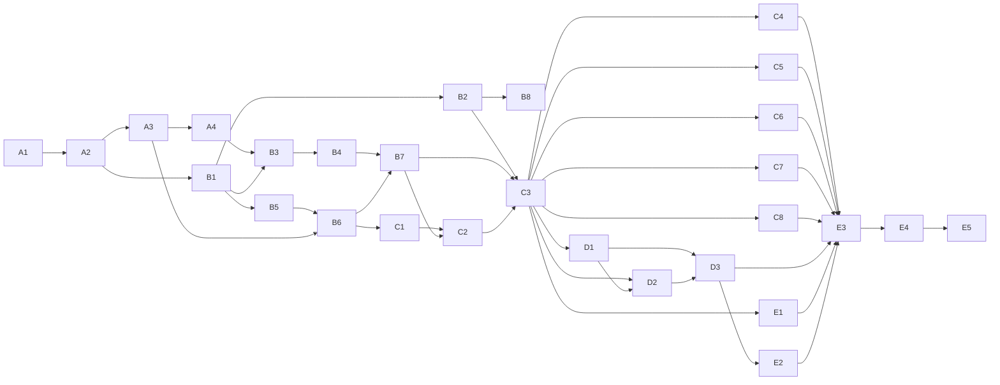

# Unified Architecture — one mutation engine for data and view

**Status:** design, under review. Nothing here is implemented yet.
**Epics:** V1 (this design), #230, and V2 (deferred features), #258 —
indexed in [`UNIFIED_ARCHITECTURE_ISSUES.md`](./UNIFIED_ARCHITECTURE_ISSUES.md).
**Delivery:** an integration branch, `epic/unified-mutations`; `main`
receives one switch-over merge when V1 is complete (§17).
**Compatibility:** none. The app has no users. The file format, the
mutation format, the in-memory model and every internal API are
redesigned to fit one architecture; nothing is kept to cater to the
current shape.

This document is the single reference every V1 sub-issue points to.
Where a sub-issue and this document disagree, this document wins
until it is amended — and it is amended in the same PR that changes
the decision, never after.

---

## §0 Decision log

The decisions below were made with the project owner and are not
reopened by implementation sub-issues. Each names the section that
develops it.

| # | Decision | § |
|---|---|---|
| D1 | The document itself becomes a baumhard `Tree`, mutated by the same engine as the glyph trees. No reverse sync from view to data, ever. | §3, §5 |
| D2 | Text is a sequence of **span** elements (text + style), not ranges over a string. | §5, §6 |
| D3 | Structure is the tree in memory; in the file it is a flat pre-order list naming parents (D30). Nodes carry a compact integer `id`, used for references (a node's `parent` among them) and external addressing. In memory, identity is the arena `NodeId`. | §5, §7 |
| D4 | The file format is strict, typed JSON with a single `format` integer; nodes are flat (D30). Unknown fields are a load error. | §7 |
| D5 | A saved node `size` is the user's explicit size and acts as a **minimum**; the node grows to fit its content. Fitted sizes are derived, never saved. | §5, §12 |
| D6 | Two kinds of map behavior, separate types in code and separate lists in the file: **Edits** (change the map, saved, undoable) and **Presentations** (perform the map, never saved). | §10 |
| D7 | A map exposes **verbs**: named step sequences that triggers, links, the console and IPC invoke. Map verbs replace the map- and node-level macro tiers. | §11 |
| D8 | Frames, connections, sections and labels are all **TextFlows**: spans laid out in a box or along a path. A frame is text along the node's outline; a connection is text along its curve. | §6 |
| D9 | Glyphs are never rotated. Curves are made by **positioning** upright glyphs, the way ASCII art makes curves. | §6 |
| D10 | Frame fit mode, start point and direction are per-frame settings. Frames hold rings (stanzas). Frame font size is relative to the node's size. There is no "grow the node" fit mode for frames; `fit` scales both font size and spacing so the text goes around exactly once. | §6 |
| D11 | Corner radius is a percentage of half the node's shorter side: 0% sharp, 100% fully round (circle on a square, pill on a rectangle). Capped at 100. | §6 |
| D12 | The node background stays a shader fill, shaped to match the frame (rounded rectangle, ellipse), with a configurable soft fade at its edge. | §13 |
| D13 | Deleted, not deferred: node `notes`, underline, node `layout`, `show_shadow` (shadow is deferred to V2), border `padding`, edge `width`, edge `line_style`, the `OnKey` trigger, `corner_radius_percent` / `frame_thickness` as they exist today (replaced by D10/D11). Edge width and line style are expressed through connection content and relative size. | §5 |
| D14 | Kept and made real: bold, italic, per-span font size, hyperlinks (links target a URL or a verb), node-level hover. | §5, §11 |
| D15 | Every stage after load does work proportional to what changed. No full-scene rebuild, scan or signature pass on an edit. | §2, §12, §13 |
| D16 | Delivery on an integration branch; `main` gets one merge. `main` is frozen for the duration — no fixes land there. Features may be temporarily absent on the branch between the cut-over and their sub-issue; `main` never sees that. | §17 |
| D17 | Presentations change fields only — never structure — but they may **hide** nodes and change their **opacity**, so a map can expand sequentially for the viewer. | §5.6, §10.2 |
| D18 | Undo history is bounded: default 50 entries, configurable in the user's `settings.json`. | §8.2 |
| D19 | The file extension is `.mandala.json`. | §7.2 |
| D20 | Keys bound to map verbs wait for the V2 trigger design. | §11.2 |
| D21 | The theme stores its variants and the *name* of the active one; the live values are read from the active variant, never stored as a second copy. | §5.3, §7 |
| D22 | A Connector (the line to the parent) is always a line. A parent-child relation shown as a portal is a hidden connector plus a portal link. `edge_type` no longer exists. | §5.6 |
| D23 | Neither pan nor zoom re-projects anything; screen-space min/max connection font sizes are dropped from V1 (V2-13). | §12.4 |
| D24 | `GlyphModel` (and its `GlyphMatrix` / `GlyphLine` / `GlyphComponent` family, its commands and deltas) stays, as a first-class part of the glyph instantiation: models are stamped onto an area and have their own operations, and they are meant for building animations. V1 keeps them working and tested; it adds no use of them. Stamping models from presentations is V2-14. | §4.2, §18 |
| D25 | A Frame element is **shown unless it says otherwise**: the built-in `visible` is `true`. A node with no Frame element draws no frame. | §5.6, §7 |
| D26 | Box flows (sections, labels) break lines at `\n` only; the box grows to fit (D5). Automatic wrapping is not in V1. | §6.1 |
| D27 | A verb target naming a node id that does not exist is **skipped at run time with a logged warning**, never a load error. Deleting a node a verb names is an ordinary delete. | §11.1 |
| D28 | **One open transaction, and who yields.** While an interactive transaction is open (text editor session, drag or resize, color picker, frame preview), any other `apply` or `begin` is refused and the user sees a short status message; a verb's `Edit` step in that state is skipped with a warning. An animated edit is not interactive: any new `apply` or `begin` first fast-forwards it to its end and commits it, then proceeds. | §9 |
| D29 | **Untrusted input is fuzzed, permanently.** Maps are shared with strangers, so every untrusted-input boundary (the `.mandala.json` loader, map-borne edits, presentations and verbs, shaping of arbitrary text, IPC frames) has a coverage-guided fuzz target (`fuzz/`, cargo-fuzz, outside the workspace), run as a short smoke on PRs and nightly once V1 is on `main`. Every finding becomes a stable regression test in `./test.sh`. Infrastructure and the loader target: V1-B8 (#278). | §16, §20 |
| D30 | **The file's node list is flat** (amends D3/D4; owner, #236). `nodes` is one array in depth-first pre-order; a node names its parent by `id` in `parent` (absent on a root) and has no `children` key. Pre-order is the one spelling and is checked in one pass; sibling order is order of appearance, so a subtree is one contiguous block. JSON nesting no longer grows with tree depth, and depth has **no bound of its own** (owner, #236 R13): like map size, it is limited only by memory. Every tree walk is iterative and linear in depth (§20 rule 11). | §7, §20 |

---

## §1 Why

Research for this design (October 2026) found that baumhard's
mutation system — the part of the project with the most thought in
it — is used only for the view, while the data model is edited by
hand-written Rust. The two have drifted since the second day of the
project. The specific findings:

1. **The engine is generic in name only.** `Tree<T, M>` has type
   parameters, but the walker (`walk_tree_from`), `MutatorTree::apply_to`,
   `Predicate`, `GfxMutator`, `Mutation`, `MutatorNode` and
   `mutator_builder::build` are all written against `GfxElement`
   and its `GlyphArea` / `GlyphModel` fields. Baumhard *cannot*
   mutate anything but glyphs. An agent that wanted to change data
   through a mutation had nothing to call — the technical root of the
   drift.
2. **The model is not a tree.** `MindMap.nodes` is a flat
   `HashMap<String, MindNode>` plus `edges: Vec<MindEdge>`. Structure
   is stored three times — `parent_id`, `parent_child` edges and the
   Dewey id — and reparent already lets them disagree
   (`format/ids.md` §"ID stability across reparent").
3. **Writes have no funnel.** About 70 non-test sites write the model
   directly, under 13 `UndoAction` variants and four undo-envelope
   helpers. Animation ticks, edge-handle drag drains and the load-time
   grow passes write with neither undo nor `mark_dirty`. A
   multi-selection edit pushes one undo entry per target.
4. **The node tree is rebuilt on nearly every commit** — including
   every advancing animation tick and every hover-target change in
   Reparent/Connect mode — and the renderer re-shapes every node
   buffer each time. The eight canvas roles re-run their data pass
   over the whole model and diff by signature; that is the one place
   "mutate, don't rebuild" is practiced.
5. **Custom mutations never run on the walker.** Only "flat" mutator
   shapes are accepted (`flat_mutations`); channels, filtering
   predicates, `Repeat`, `MapChildren` and runtime holes are skipped
   with a log line. Persistent results reach the model through
   `document/custom/sync.rs`, 1,059 lines of heuristics that reverse
   a lossy projection. Animations interpolate position only, and the
   nudge vocabulary is defined three times. CONCEPTS §4,
   `format/mutations.md` and `mutation inspect` all describe a walker
   path that does not exist.
6. **The model carries debt beyond the split.** Dead fields (`layout`,
   `notes`, `corner_radius_percent`, `frame_thickness`, `show_shadow`,
   edge `width` / `line_style`, border `padding`); dropped fields (run
   bold/italic/underline/hyperlink, per-run size collapsed to a max,
   border and connection `font`, control points past the second);
   every enum, color and font family kept as a `String` and parsed
   inside projection passes, colors theme-resolved four to six times
   per node per build; derived data persisted (grown `size`,
   `color_schema.level`, baked colors, fork-on-edit copies of canvas
   defaults); var refs that never resolve in border colors and palette
   groups; whole-struct rather than per-field default inheritance.
7. **Every border and connection glyph is its own `GlyphArea`,
   shaped as its own cosmic-text buffer.** That shape cannot carry
   text-bearing frames or connections at any useful density.

How it happened: the serde model existed before the tree bridge; the
tree bridge was built *from* it; the drag milestone on 2026-04-10
settled on "preview on the tree, commit to the model, rebuild", and
every later feature copied it. The written rules said "where
possible", §B2 was read as an arena-reuse rule, and the walker-based
apply path was deferred on 2026-04-17 and never scheduled.

The fix is not a patch to any one of these. It is one architecture in
which they cannot occur.

---

## §2 Principles

These are the tests every V1 sub-issue's review applies.

1. **One engine.** Every state change in the app — to the map's data
   or to what is drawn — is a baumhard mutator tree applied by the
   walker to a baumhard tree. There is no second way to change state.
2. **One home per fact.** A fact is stored once. Anything that can be
   computed from stored facts (tree structure, theme depth, fitted
   sizes, resolved colors, sibling order) is computed and never
   saved.
3. **Typed at rest.** Strings are parsed once, at load, into enums,
   RGBA values, interned font ids and theme-variable indices. No
   projection, drag drain or frame parses a string.
4. **Work proportional to change.** After load, every stage handles
   exactly what changed: a document journal names the touched
   elements, the projector re-projects those and their dependents,
   the glyph journal names the touched glyph elements, and the
   renderer reshapes or re-places exactly those. Panning does
   nothing to any tree.
5. **The data and the view agree exactly.** Every document field has
   exactly one projection. Nothing is stored that is not drawn or
   used; nothing is drawn that is not stored or derived from stored
   facts.
6. **Changing the map and performing the map are different things,
   and the code makes it impossible to confuse them** (§10).
7. **Both targets, always.** Everything in this design compiles and
   runs on native and wasm32. The CLAUDE.md "Dual-target status"
   carve-outs are unchanged by it, and it adds none.
8. **Interactive paths never panic** (CODE_CONVENTIONS §9 is
   unchanged). A malformed mutator degrades to a no-op with a
   diagnostic; it never aborts an apply half-way, because the journal
   guarantees an apply is all-or-nothing (§8).

---

## §3 Overview

```
 Edit mutators ─┐   (actions · console · IPC · drags · edit handlers · verbs)
                │   walker: kind+channel routing, anchored → Journal
                ▼
 Document  =  Tree<DocElement, DocMutation>  ◀── load / save ──▶  .mandala.json (§7)
                │
 Presentation layer (§10): presentation mutators re-applied on top; never saved
                │
                │  Journal ⊕ dependency index (§12) → dirty set
                ▼  projector — forward only
 Glyph mutators ── walker ──▶ glyph layers  =  Tree<GfxElement, GfxMutation> per layer
                │                       │
                │                       └── glyph Journal → reshape / re-place set (§13)
 View-only glyph mutators                ▼
 (selection, dimming, hover chrome,   renderer: TextFlow runs, backgrounds → GPU
  glyph-layer presentations,
  console, color picker)
```

The same engine — one tree type, one walker, one mutator language,
one journal — runs in two instantiations: the **document**, which is
saved, and the **glyph layers**, which are drawn. Data only ever
flows downward. Nothing reads the glyph layers to learn what the
document is.

Four flows, end to end:

- **An edit** (recolor the selection): the action builds one
  `DocMutation` mutator anchored at every selected node →
  `Document::apply` walks it, journals the touched fields → one undo
  entry → the projector maps the journal through the dependency
  index (the nodes, their frames, the connections whose color
  inherits from them) → glyph mutators update exactly those glyph
  elements → the renderer reshapes exactly those runs.
- **A drag**: a transaction (§9). Each drain frame reverts the
  previous frame's journal and applies `position += total_delta` —
  two small journals, the same projection path. Release commits one
  undo entry; Escape reverts.
- **A hover presentation**: the trigger invokes a verb (§11); the
  verb starts a presentation (§10) on the hovered node; the
  presentation layer applies it, animated, on top of the document;
  projection is the same as for an edit; the document is never
  marked changed. Leaving the node plays it back out.
- **Load**: parse (§7) → build the document tree → one full
  projection into the glyph layers → shape every run once. This is
  the only full pass in the life of a document.

---

## §4 The engine (baumhard)

Everything in this section lives in `lib/baumhard` and is generic.
The glyph instantiation is the first client; the document is the
second. Neither is special-cased in the engine.

### §4.1 Elements and routing keys

```rust
pub trait TreeElement: Clone {
    type Kind: Copy + Ord + Eq + Hash + Debug;
    type Inherited: Clone + Debug;          // carried down every walk (§4.2)
    fn key(&self) -> BranchKey<Self::Kind>;
    fn inherit(&self, parent: &Self::Inherited) -> Self::Inherited;
    fn void() -> Self;
}

#[derive(Copy, Clone, Eq, PartialEq, Ord, PartialOrd, Hash)]
pub struct BranchKey<K> { pub kind: K, pub channel: usize }
```

(The full trait, with caches, spatial bounds, state comparison and
split / merge, is specified in V1-A1 to A4. **The code blocks in this
section are illustrative; the exact signatures are those of V1-A1 to
A4**: for example `apply_at(tree, &Anchors, seed_for) -> Result<(),
TreeError>` and the journaled `apply_at_journaled(…, &mut
JournalBuilder<E>)`, a `Journal` closed from a `JournalBuilder` whose
`revert` / `replay` return `Result`, `StructOp::Move { to: NodeId, at
}`, and `Merge` absorbing the next equal-key sibling.)

The walker routes on `(kind, channel)`, not on channel alone. A
mutator addressed to `(Section, 0)` cannot land on `(Node, 0)` or
`(Link, 0)` under the same parent. This removes the class of problem
the current section fan-out hack in `document/custom/mod.rs` exists
for, and lets one parent hold children of several kinds whose channel
spaces are independent.

**Sorted-children invariant.** A parent's children are always kept in
`BranchKey` order (stable among equal keys). Structural commands
(§4.4) insert at the right place. The walker therefore merges a
mutator row against a target row by walking both sibling lists in
step, with no `Vec` allocation and no sort — today's walker collects
and sorts both rows at every visited node (`collect_sorted_children`).

### §4.2 Mutations and mutators

```rust
pub trait Mutation<E: TreeElement>: Clone {
    /// Apply to one element. Mutations know nothing about journals:
    /// the walker records the element's before-image the first time
    /// it touches the element within a journal (§4.5). `inherited`
    /// is the target's parent's inherited state (below).
    fn apply_to(&self, target: &mut E, inherited: &E::Inherited);
}

pub enum Mutator<E: TreeElement, M: Mutation<E>> {
    Void        { key: BranchKey<E::Kind> },
    Single      { key: BranchKey<E::Kind>, mutation: M },
    Macro       { key: BranchKey<E::Kind>, mutations: Vec<M> },
    Instruction { key: BranchKey<E::Kind>, instruction: Instruction<E>, mutation: Option<M> },
    Structure   { key: BranchKey<E::Kind>, op: StructOp<E> },
}
pub type MutatorTree<E, M> = /* arena of Mutator<E, M> + root */;
```

**Inherited state.** Some mutations need a value their element
inherits rather than stores — "grow font by 2 pt" on a span with no
size of its own must grow the size it displays. The walker therefore
carries `E::Inherited` down every walk: a mutation receives its
target's parent's state (after the parent's own mutations in the same
walk), and the walker computes `inherit` for the children. The state
lives on the walker's stack — no allocation per visited node. Glyph
trees use `()`; the document uses the resolved text size and whether
the walk is inside a frame (V1-B3).

`GfxMutator` becomes `Mutator<GfxElement, GfxMutation>` (today's
`Mutation` enum is renamed `GfxMutation`); the document uses
`Mutator<DocElement, DocMutation>` (§5). The glyph instantiation has a
single element kind (`Kind = ()`), so glyph routing stays
channel-only, exactly as today; kinds matter for the document. Instructions keep their
meaning: `RepeatWhile(Predicate)`, `MapChildren`, and
`SpatialDescend(point)` — the last available only for element types
that implement `Spatial` (glyph elements do; document elements do
not). `RotateWhile`, a reserved and never-implemented stub today, is
removed from V1 and documented in the V2 epic.

### §4.3 Predicates, the AST and the builder

`Predicate` becomes `Predicate<E>` over a per-element field selector
(`E::Field`), with the existing `Comparator` set. The `MutatorNode`
AST, `Repeat`, runtime holes (`SectionContext`, renamed
`BuildContext`) and `build` become generic over `(E, M)`. One JSON
authoring surface therefore serves document edits, presentations in
document vocabulary, and glyph-layer presentations; the element type
is fixed by where the mutator is used, never guessed.

### §4.4 Anchored walks and structural commands

```rust
impl<E, M> MutatorTree<E, M> {
    pub fn apply_at(&self, tree: &mut Tree<E>, anchors: &[NodeId], journal: &mut Journal<E>);
}
```

A walk starts at its anchors — typically the selection — and the
mutator's root applies to each anchor whose **kind** matches (the
root's channel is not compared). Work is proportional to the reached
subtree, never to the whole tree. Relative anchors resolve to
concrete anchors before the walk: `ParentOf` to the distinct parents,
`SiblingsOf` to each node's same-kind siblings excluding itself. When
a mutator reaches below its root, an anchor whose ancestor is also an
anchor is dropped, so a subtree mutation reaches every element exactly
once. Each anchor's inherited-state seed is computed before any anchor
is walked.

**Structural commands** are a first-class mutator variant:

```rust
pub enum StructOp<E> {
    Insert { subtree: Subtree<E>, at: Placement },   // child of the target
    Remove,                                           // the target and its subtree
    Move   { to: AnchorRef, at: Placement },          // re-parent the target
    Split  { at: E::SplitPoint },                     // e.g. a span at a grapheme
    Merge  { with: Sibling },                         // e.g. two adjacent equal-style spans
}
```

They apply in a **second phase**: the walk collects `(target, op)` in
walk order and applies them after it ends, so the walk never iterates
a sibling list it is changing. Removal **detaches** rather than
frees: the subtree stays in the arena, owned by the journal entry,
so undo re-attaches the same `NodeId`s and every reference to them
stays valid. The arena slot is freed when the journal entry leaves
the history. indextree 4.9's per-slot stamps make any stale `NodeId`
detectable.

### §4.5 Journals

```rust
pub struct Journal<E: TreeElement> { entries: Vec<Entry<E>> }
enum Entry<E> {
    Field  { node: NodeId, before: E, after: E },
    Insert { node: NodeId, parent: NodeId, prev: Option<NodeId> },
    Remove { node: NodeId, parent: NodeId, prev: Option<NodeId> },  // subtree kept detached
    Move   { node: NodeId, from: (NodeId, Option<NodeId>), to: (NodeId, Option<NodeId>) },
}
impl<E> Journal<E> {
    pub fn revert(&self, tree: &mut Tree<E>);   // exact inverse, newest first
    pub fn replay(&self, tree: &mut Tree<E>);   // exact forward, oldest first
    pub fn touched(&self) -> impl Iterator<Item = (NodeId, Touch)>;
}
```

- A field entry is written once per element per journal: the
  **walker** records `before` immediately before its first
  `apply_to` on that element, and `after` is read when the journal
  closes. A mutator that touches a node many times costs one entry,
  and no `Mutation` implementation can forget to journal.
- `revert` and `replay` are exact. Undo and redo are `revert` and
  `replay`; nothing is re-evaluated, so an undo can never disagree
  with what the edit did.
- `touched()` is what the projector (§12), the IPC event stream
  (§14) and the renderer (§13, for the glyph journal) consume.
- Elements are kept small enough that a before/after clone is cheap:
  text lives in span children (§5), not in nodes.

### §4.6 Interpolation

```rust
pub trait Interpolate: Sized { fn lerp(from: &Self, to: &Self, t: f32) -> Self; }
```

Implemented for scalars, `Vec2`, sizes and RGBA. Each element type
declares which of its fields interpolate; the rest switch at a
declared point (`snap: start | end`, default `end`). Given a journal
(`before`, `after` per touched element), an animation at progress `t`
writes `lerp(before, after, t)` field-wise. This is what makes any
numeric, position or color change animate (§10) without per-field
animation code.

### §4.7 Cost rules the engine keeps

- No allocation per visited node on the walk (sorted-children
  invariant).
- No string compares or hashing on the walk; keys are `Copy` integers.
- Journals allocate per touched element, not per visited element.
- Every new primitive in this section ships a bench entry beside it
  (baumhard CONVENTIONS §B8); `cargo check --workspace --benches`
  proves they build. Benchmarks are not run by agents (CLAUDE.md §6),
  and no performance claim is made — work removed is stated as a fact
  visible in the diff.

---

## §5 The document

The document is `Tree<DocElement, DocMutation>` (§4), owned by a
`Document` type in `lib/baumhard/src/document/`, which replaces
`MindMap` and the free-standing model under
`lib/baumhard/src/mindmap/model/`. `MindMapDocument` in the app keeps
what is genuinely app state — selection, camera, mode, the open
transaction, the presentation runtime — and holds a `Document`.

### §5.1 Shape

```
Map                       (root; exactly one)
├─ Theme                  variants (name → variables: name → RGBA), active (a variant name)
├─ Palette*               ordered color groups (fill / frame / text / title per depth)
├─ Defaults               per-field defaults for frames, rings, connectors, links, labels, spans
└─ Node*                  roots, in sibling order
    ├─ Section*           a box TextFlow
    │   └─ Span*
    ├─ Frame?             the node's outline TextFlows
    │   └─ Ring*          one stanza per ring, innermost first
    │       └─ Span*
    ├─ Connector?         the line to the parent (absent on roots)
    │   ├─ Span*          the line's content ("─", "·", a line of poetry)
    │   ├─ CapStart? / CapEnd?  → Span*
    │   └─ Label?         → Span*
    ├─ Link*              a cross-link or portal to another node
    │   ├─ Span* / CapStart? / CapEnd? / Label?        (line links)
    │   └─ PortalEnd ×2   (portal links) → Span* (marker), Label?
    └─ Node*              children, in sibling order
```

Each element kind has its own channel space (§4.1). Sibling order is
the arena order, which the sorted-children invariant keeps within a
`(kind, channel)` key in insertion order; reordering siblings is a
`Move` with a `Placement`.

**What this removes:** `parent_id`, `parent_child` edges, Dewey ids,
`edge_type`, the `MindMap.nodes` map and its key-equals-`id` check,
`color_schema.level` (depth is the tree), `theme_variables` as a
persisted copy of a variant (the live variant is a field naming it),
fork-on-edit copies of defaults, and the section-level trigger
bindings (triggers are node-level, D14).

### §5.2 Identity

- **In memory:** the arena `NodeId`. Selection, transactions,
  journals, the projection map, presentations and link targets hold
  `NodeId`s. No string is hashed to find an element.
- **On disk and from outside:** a node carries `id: u32`, unique within
  the map and never reused within it. It exists so links and verbs can
  reference nodes in the file, and so the console, IPC and
  `mandalactl` can name a node. One `id → NodeId` index serves those
  external callers and the loader; no internal path consults it.
- A node inserted by a mutation carries the reserved ident `0`
  (unassigned); `Document::apply` assigns the next id in tree order.
- **The id rule:** at load the counter starts at `max_id + 1`; within
  a session it only increases, so an id is never reused while the
  document is open. The counter is not saved (§2.2): after a save and
  reload, the id of a node deleted at the top of the range may be
  issued again. Ids do not encode structure, so moving a node never
  renames anything.

### §5.3 Typed values

| Concept | Type | Replaces |
|---|---|---|
| Color | `ColorRef = Rgba([u8;4]) \| Var(VarId) \| Palette(PaletteField)` | hex / `var(--x)` strings resolved per build |
| Font | `FontId` (interned at load) | family-name strings scanned per run per build |
| Font size | `FontSize = Pt(f32) \| Rel(f32)` — `Rel` is a fraction of the node's shorter side (frames only) | `size_pt` collapsed to a max |
| Shape | `Shape::{Rectangle { radius: Percent }, Ellipse}` | `shape: String` parsed twice per node per build |
| Anchors | `Anchor::{Auto, Top, Right, Bottom, Left}` | `anchor_from` / `anchor_to` strings matched per frame |
| Link kind | `LinkKind::{Line, Portal}` | `display_mode` string compared per pass |
| Weight, style | `Weight`, `italic: bool` | dropped run flags |
| Link target | `LinkTarget::{Url(String), Verb(VerbId)}` | `hyperlink` string with no renderer |

`Palette(field)` resolves against the node's palette binding at the
node's **depth**, computed from the tree. A theme-variant switch is
one mutation of `Theme.active`; the dependency index (§12) knows
which elements read which variables.

### §5.4 Style inheritance

Every style field on every element is an `Option`. Resolution is
**per field**, never per struct:

```
element field → owning node's field (for spans: section → node) → node's palette binding
             → Defaults → built-in default
```

**The palette tier.** A node bound to a palette (`palette: p`)
colors itself and its descendants by depth, for every field that is
`None` up to that tier: group = `depth(node) − depth(binding node)`,
clamped to the last group; the nearest ancestor-or-self binding wins.
Field mapping: node `fill` ← group `fill`; frame and ring text color ←
group `frame`; section text color ← group `text`, except the node's
first section (lowest channel), which takes group `title` when the
group sets one. Connectors, links and labels are not palette-colored.
An explicit `ColorRef::Palette(field)` written on any element resolves
against the same binding.

A node that sets only a frame's `fit` still inherits everything else
from `Defaults`; editing one field never copies a default into the
element. Resolved values are computed by the projector, cached in
projection state, and invalidated through the dependency index (§12)
— never recomputed on every pass.

### §5.5 Size (D5)

`Node.min_size: Option<Vec2>` is the size the user set by resizing.
The drawn size is `max(min_size, fitted content size)`, where the
fitted size comes from measuring sections (§6.4). Fitted sizes live
in projection state, never in the document, and are recomputed only
when a section's spans, fonts or sizes change. `Section` has the same
`min_size` semantics within its node.

### §5.6 Element fields (summary)

The authoritative field list is `format/schema.md` (rewritten in
V1); this is the shape.

- **Node:** `id`, `position`, `min_size?`, `shape`, `fill?`,
  `fill_fade?` (edge fade width, D12), `palette?`, `zoom?` (min/max),
  `folded`, `hidden`, `opacity`, `on { click?, hover? }` (verb refs,
  §11), and text defaults (`font?`, `size?`, `color?`) inherited by
  its spans.
  - `hidden: bool` (default `false`): the node, its subtree, its
    connector and every link touching the subtree are not projected
    and cannot be hit. Unlike `folded`, which collapses a node's
    descendants and keeps the node, `hidden` removes the node itself.
  - `opacity: f32` in `0.0..=1.0` (default `1.0`): multiplies the
    alpha of everything the node draws — fill, frame, sections,
    connector — and **multiplies down the subtree**, so fading a
    node fades its descendants. Interpolates.
  - Both exist mainly for presentations (D17, §10.2): a sequential
    reveal is a `hold` presentation that sets `hidden` / `opacity`
    on the nodes still to come, stopped node by node.
- **Section:** `offset`, `min_size?`, `align?`, text defaults.
- **Frame:** `visible`, `start`, `direction`, `fit`, `gap` (between
  rings), `inset` (distance from the outline), text defaults.
- **Ring:** `size?` (a `Rel` font size), `fit?` (overrides the
  frame's), text defaults.
- **Span:** `text`, `font?`, `size?`, `color?`, `weight?`, `italic?`,
  `link?`.
- **Connector / Link (line):** `anchors`, `control_points` (0, 1 or
  2: a line, a quadratic or a cubic Bézier), `fit`, `spacing?`,
  `size?`, `color?`, `content?` (drawn when the path has no spans),
  `visible`, `zoom?`; a Link also has `to: NodeRef` and `kind`. A
  Connector is always a line (D22).
- **PortalEnd:** `border_t?`, `offset?`, `color?`, `size?`,
  `content?` (the marker drawn when the end has no spans).
- **Label:** `t` (position along the path), `offset`, text defaults.

### §5.7 Definitions the document carries but does not mutate in V1

Edits, presentations and verbs (§10, §11) are definitions: loaded,
validated, saved, and invoked, but not changed by any V1 code path —
there is no in-app authoring for them in V1 (V2 epic). They are held
by `Document` beside the tree, not as tree elements.

---

## §6 TextFlow — all text, one primitive

### §6.1 The concept

> **A TextFlow is a sequence of spans plus a layout.**

| Where | Layout |
|---|---|
| Section, Label | **Box** — breaks lines at `\n` only, grows the box (§5.5, D26) |
| Frame ring | **Closed path** — the node's outline, offset outward per ring |
| Connector, line Link | **Open path** — the connection curve |
| PortalEnd marker | **Point** — a single placed run |

One content model (spans), one shaping cache, one placement
primitive, one renderer path (§13). A frame can hold a poem; a
connection can be a line of verse from parent to child. Box-drawing
glyphs (`─`, `━`, `═`) are ordinary content, not presets.

### §6.2 Upright glyphs, positioned along a path (D9)

Glyphs are never rotated. A path flow is shaped once as a single
line (cosmic-text gives each glyph's advance), then placed:

1. Walk the path by arc length from the flow's start point in its
   direction.
2. Each glyph occupies a step whose length depends on the direction
   of travel θ at that point:
   `step = |cos θ| · advance + |sin θ| · line_height`.
   Along a horizontal stretch glyphs sit side by side; along a
   vertical stretch they stack one line apart; on a curve the two
   blend — the way ASCII art builds a curve.
3. The glyph's center sits on the path, offset along the outward
   normal by half its extent, so text sits on the outline rather
   than across it. Ring *k* is placed on the outline offset outward
   by `inset + Σ(thickness of rings < k) + k · gap`.

### §6.3 Outlines and corner radius (D11)

The outline is derived from the node's drawn rectangle and its shape:

- `Rectangle { radius }`: a rounded rectangle whose corner radius is
  `radius% × (min(width, height) / 2)`. 0% gives sharp corners; 100%
  gives a circle on a square node and a pill (straight sides,
  semicircular ends) on a wide one. Values are capped at 100.
- `Ellipse`: the inscribed ellipse.

The node's background fill (§13.4) uses the same outline, so the fill
and the glyph frame always agree.

### §6.4 Fit modes (D10)

When a flow's text is shorter or longer than its path:

| Mode | Behavior | Frames | Connectors |
|---|---|---|---|
| `once { filler? }` | Text placed once from the start; the rest of the path gets the filler span repeated, or nothing | ✓ | ✓ |
| `repeat` | Text repeated until the path is full; the last repetition is cut at a grapheme boundary | ✓ | ✓ (default — a `─` pattern) |
| `spread` | Text placed once with extra spacing distributed so it ends exactly at the path's end | ✓ | ✓ |
| `fit { min, max }` | Font size **and** spacing are scaled so the text fills the path exactly once (algorithm below) | ✓ (default) | ✓ |

**There is no "grow the node" mode for frames.** Ring font size is
relative to the node's size (D10), so the text's length and the
outline's perimeter scale together; growing the node never makes the
text fit. `fit` is the mode that answers "the poem, exactly once,
all the way around." (Box flows — sections and labels — grow their
box, D5.)

**The `fit` algorithm.** Let `L` be the flow's natural length along
the path at its declared size (the sum of §6.2 steps), and `P` the
path's length. Every step scales linearly with font size, so a scale
factor `s` gives length `s · L`.

1. `s = clamp(P / L, min, max)` (defaults `min = 0.5`, `max = 2.0`;
   both are multiples of the ring's declared size).
2. Lay the text out at `s ×` the declared size.
3. The remaining difference `P − s · L` — zero unless step 1 clamped
   — is distributed as equal extra spacing between glyphs (negative
   when the text is too long), so the last glyph ends exactly at the
   path's end.
4. If the text is still too long at `min` with spacing reduced to
   zero gap between glyph extents, it is cut at the last grapheme
   boundary that fits. Spacing never goes below zero gap: glyphs
   never overlap.

`start` (a point on the outline: a corner or a side plus a fraction)
and `direction` (clockwise / counter-clockwise) are per frame;
connectors start at their source end.

### §6.5 What is shaped, and when

- A flow is shaped when its spans, fonts or sizes change — and only
  then. Moving a node re-places its flows without reshaping; resizing
  re-places box flows and re-shapes `Rel`-sized rings (their font
  size changed), for that node only.
- Box-flow measurement (the fitted size, §5.5) comes from the same
  shaping and is cached with it.
- Hit testing maps a placed glyph back to its span through the
  projection map, which is how a click on a linked span finds its
  link (§11).

---

## §7 The file format

### §7.1 Shape

Strict, typed JSON (D4) with a flat node list (D30): `nodes` is the
tree in depth-first pre-order, each node naming its `parent` by `id`
(absent on a root). Sibling order is order of appearance, so every
subtree is one contiguous block of the list, and the file's JSON
nesting is the same at any tree depth.

```json
{
  "format": 1,
  "name": "Testament",
  "theme": {
    "active": "dark",
    "variants": {
      "dark":  { "bg": "#101014", "fg": "#e0e0e0", "accent": "#d4a24c" },
      "light": { "bg": "#f6f3ec", "fg": "#202024", "accent": "#8a5a00" }
    }
  },
  "palettes": {
    "rainbow": [ { "fill": "#2a1b3d", "frame": "#a239ca", "text": "#e0e0e0", "title": "#ffffff" } ]
  },
  "defaults": {
    "ring":      { "size": 0.06, "color": "var(accent)" },
    "connector": { "content": "─", "fit": "repeat", "size": 12 }
  },
  "edits":         [ ],
  "presentations": [ ],
  "verbs":         [ ],
  "nodes": [
    {
      "id": 1,
      "position": [0, 0],
      "shape": { "rectangle": { "radius": 25 } },
      "palette": "rainbow",
      "sections": [
        { "spans": [ { "text": "In the beginning", "size": 24, "weight": "bold" } ] }
      ],
      "frame": {
        "fit": "fit", "start": "top-left", "direction": "clockwise",
        "rings": [ { "spans": [ { "text": "And the earth was without form, and void; " } ] } ]
      },
      "on": { "hover": "glow", "click": "reveal-chapter-2" },
      "links": [ { "to": 9, "kind": "portal" } ]
    },
    { "id": 2, "parent": 1, "position": [320, 40], "connector": { "spans": [ { "text": "·" } ] },
      "sections": [ { "spans": [ { "text": "the heaven and the earth" } ] } ] }
  ]
}
```

### §7.2 Rules

- **Strict.** Every type denies unknown fields; an unknown key, a
  wrong type, a dangling `to` / verb reference or a duplicate `id` is
  a load error naming the JSON path. There is no preserved-unknown-keys
  mechanism and no skipped-construct report — a map is either valid
  or it does not load.
- **Typed on read.** `"var(accent)"`, palette names, font families,
  shapes, anchors, fit modes, weights and verb references are
  resolved to their typed forms (§5.3) during parsing; the document
  never holds the string forms.
- **Flat, pre-order** (D30). A node's `parent` must be on the
  ancestor chain of the node before it (or absent, for a new root);
  anything else, including a parent that appears later, a missing
  one or the node itself, is a load error naming that node's path.
  Depth itself is never an error (D30).
- **Nothing derived is written.** No fitted sizes, no depth, no
  child lists, no resolved colors, no copied defaults. Optional
  fields equal to their inherited value are omitted on save.
- **Deterministic output.** Keys in schema order, nodes in
  depth-first pre-order, numbers in a canonical form, so an unchanged map saves
  byte-identically and a one-field edit is a one-line diff.
- **One pass.** Load is parse → build the tree with links and verb
  references resolved through a load-time `id → NodeId` table →
  validate. Save is one walk.
- **Platform limits.** `MAX_MAP_BYTES` (wasm32 only, platform physics)
  stays as it is. `MAX_UNKNOWN_KEYS` is deleted with the mechanism it
  bounded.
- **Extension.** `.mandala.json` (D19), so a file in the old format
  is never mistaken for one in the new. The WASM build's `?map=`
  parameter and every tool accept only this extension.

### §7.3 What happens to existing maps and tools

- The repository's maps (`maps/*.mindmap.json`, test fixtures) are
  converted **once**, in the cut-over sub-issue, by a throwaway
  script that is not committed. The converted maps are checked by
  screenshot against the old app's rendering.
- `maps/testament.mind` (the miMind original) and every legacy path
  are deleted: the baumhard loader's legacy shapes, `maptool convert`
  (`--legacy`, `--portals`, `--sections`), `format/migration.md`,
  `crates/maptool/src/migration_advice.rs`, the legacy custom-mutation
  shape (`mutations` + `target_scope`), and `unknown_keys.rs`.
- `maptool` is rebuilt as a client of `Document` (§14): `show`,
  `grep`, `export` and `verify` read through it; `apply` runs its
  command and writes through `Document::apply`.

---

## §8 One writer

### §8.1 The API

```rust
impl Document {
    pub fn apply(&mut self, req: EditRequest, source: ChangeSource) -> Result<Revision, ApplyError>;
    pub fn undo(&mut self) -> Option<Revision>;
    pub fn redo(&mut self) -> Option<Revision>;
    // §9
    pub fn begin(&mut self, source: ChangeSource) -> Result<Transaction, ApplyError>;
    pub fn stage(&mut self, tx: &Transaction, req: EditRequest) -> Result<(), ApplyError>;
    pub fn commit(&mut self, tx: Transaction) -> Option<Revision>;
    pub fn cancel(&mut self, tx: Transaction);
}

pub struct EditRequest { pub mutator: DocMutatorTree, pub anchors: Anchors, pub label: String }
```

(Illustrative, as in §4: the exact signatures are V1-B4's.)

`Document::apply` is the **only** way the document changes after
load. Actions, console verbs, IPC, drags, the text editor, the color
picker, frame previews, edit handlers, animated edits and verbs all
build an `EditRequest` and call it (or the transaction API, §9).

### §8.2 Guarantees

- **All or nothing.** If any mutation in a request fails validation,
  the request's journal is reverted and an `ApplyError` names the
  element and field. The document is never left half-applied.
- **Validation lives in the mutations.** Numeric bounds (canvas
  coordinates, font sizes, radius 0–100, `Rel` sizes), structural
  rules (no node moved under its own descendant; removing a node also
  removes links that target it, journaled) and reference integrity
  are checked where the value is written. A setter can no longer
  forget a bound the loader enforces (issue #208's class).
- **One history.** Each successful `apply` or `commit` pushes one
  history entry: its journal, its `ChangeSource` and its label. Undo
  reverts, redo replays (§4.5); a new apply clears the redo branch.
  A multi-selection edit is one request with several anchors — one
  entry. The history holds at most `history_limit` entries (D18):
  default **50**, set in the user's `settings.json` (a new file in the
  existing `user_config` layering — the XDG config directory on
  native, `localStorage` on wasm32). Dropping the oldest entry frees
  the subtrees its journal detached.
- **Revision and dirty.** Every apply, commit, undo and redo advances
  the revision. `dirty` is `revision != saved_revision`, so undoing
  back to the saved state is clean again.
- **Sources.** `ChangeSource::{Action, Console, Ipc, Input, Edit,
  Verb, Undo, Redo, Presentation}`. Every apply declares one; there is
  no fallback. `Presentation` tags the presentation layer's changes
  in the change feed (§12), which never enter the history.

### §8.3 What it replaces

The 13 `UndoAction` variants, `undo.rs`, `undo_action.rs`, the
undo-envelope helpers (`mutate_node_with_*_undo`), `mutate_edge`,
`closure_helpers` fork-on-edit, per-setter undo pushes in app code
(`moving_node.rs`, `dispatch/native.rs`), `with_source`, and
`mark_dirty` as a call sites must remember.

### §8.4 The gate

A source-scan test (the pattern of
`test_no_production_code_sets_dirty_directly`) fails if any code
outside `lib/baumhard/src/document/` obtains a mutable reference to a
document element or the document tree. The loader constructs; apply
writes; nothing else does.

---

## §9 Transactions — live interaction

A transaction is a staged edit that is re-staged every frame and
becomes one history entry when it ends.

```
begin ─▶ stage(req₁) ─▶ stage(req₂) ─▶ … ─▶ commit   (one undo entry)
                                       └──▶ cancel   (document as before begin)
```

`stage` reverts the previous staged journal and applies the new
request — so a drag stages `position += total_delta` each frame,
never an accumulation of per-frame deltas, and the document is exact
at every frame. Staged changes flow through projection like any
other change (§12): the drawn result of a drag *is* the document,
not a preview painted over it.

| Interaction | Staged request |
|---|---|
| Node / subtree move | `position += Δ` at each moved node |
| Section move, node / section resize | `offset += Δ`, `min_size = s` |
| Connector / link handle drag | control point, anchor |
| Label / portal-label drag | `t`, `offset`, `border_t` |
| Text editing (sections, rings, labels, path content, single-line editors) | `replace_spans` from the editor's span buffer, once per change — one undo entry per session, as today |
| Color picker hover, frame/border preview | the previewed field |
| Animated edit (§10) | the edit's journal interpolated at `t` |

Rules:

- At most one transaction is open at a time. Who yields when a second
  change arrives is D28: interactive transactions refuse it; an
  animated edit is fast-forwarded and committed first.
- `stage` and `cancel` discard the reverted staged journal
  (`Journal::discard`), so a long editing session frees what each
  stage detached.
- `undo` while a transaction is open cancels it first.
- Saving while a transaction is open writes the committed state:
  revert the staged journal, serialize, replay — cost proportional to
  what is staged.
- This deletes every bespoke preview mechanism: drag offsets applied
  to the tree (`apply_drag_delta*`, `apply_*_resize_to_tree`), the
  text editor's direct `DeltaGlyphArea` writes, `label_edit_preview`,
  `portal_text_edit_preview`, `color_picker_preview`,
  `border_preview`, and the per-frame model writes of the edge-handle
  and label drags.

---

## §10 Edits and Presentations (D6)

A map has two kinds of behavior, and the design keeps them apart at
every level: different Rust types, different lists in the file,
different console commands, different rules.

| | **Edit** | **Presentation** |
|---|---|---|
| Purpose | Change the map | Perform the map |
| Saved | Yes | Never |
| Undo | One history entry | Never in history |
| Marks the map changed | Yes | No |
| Document revision | Advances | Unchanged (has its own presentation epoch for IPC events) |
| Animation | Optional — animates into place, then commits | The usual case |
| Structural commands | Allowed | Not allowed (load error) — but `hidden` and `opacity` are fields, so presentations can hide, reveal and fade nodes (D17) |
| Typical triggers | Key binding, console, command; a verb step | Hover, click, links, verbs |
| Examples | flower layout, tree cascade, grow font | hover lift, click pulse, shimmer, reveal |

The names are the API: `EditDef` / `PresentationDef` in code,
`"edits"` / `"presentations"` in the file, `edit …` / `present …`
on the console. "Persistent", "Toggle" and `target_scope` are gone.

### §10.1 Edits

```json
{ "id": "grow-font", "name": "Grow font", "mutator": { … }, "animate": { "ms": 200, "easing": "ease-out" } }
{ "id": "flower-layout", "name": "Flower arrangement", "handler": "flower", "animate": { "ms": 400 } }
```

- **Declarative edits** declare a **reach** (`self`, `children`,
  `descendants`, `subtree`, `parent`, `siblings` — node sets relative
  to the anchors), a **target** (`node`, `sections`, `spans`,
  `frame`, `rings`, `connector`, `links`, `labels` — elements within
  those nodes) and an optional predicate `filter`. The resolved
  elements become the request's anchors, and the edit's mutations
  apply once to each. An advanced form carries a full mutator AST
  (§4.3) instead. Authored edits cannot move nodes or insert links;
  those need arena ids and belong to handlers.
- **Handler edits** name a Rust handler for algorithms the AST cannot
  express (radial and cascade layouts). A handler is
  `fn(&Document, &Anchors) -> DocMutatorTree`: it **reads** the
  document and **returns a mutator**. It never writes. That is what
  gives every handler undo, animation and IPC events for free.
- **Animated edits** run as a transaction (§9): apply once to learn
  the journal's before/after values, then stage the interpolation at
  each frame (§4.6), then commit — one history entry, identical to
  the instant edit. `undo` during the animation cancels it.
- **Sources** keep the existing precedence, App < User < Map:
  `assets/edits.json` (bundled), the user's `edits.json`, and the
  map's `"edits"`. The node-inline tier is removed: definitions live
  at map level, and a node refers to them through verbs.

### §10.2 Presentations

```json
{ "id": "glow",    "play": "while", "mutator": { … }, "animate": { "ms": 150 }, "return": { "ms": 300 } }
{ "id": "pulse",   "play": "once",  "mutator": { … }, "animate": { "ms": 120 } }
{ "id": "shimmer", "play": "loop",  "layer": "glyph", "mutator": { … }, "animate": { "ms": 900 } }
```

**Lifecycle (`play`):**

| `play` | In | Holds | Out |
|---|---|---|---|
| `while` | animates in on start | while its trigger holds (hover) or until stopped | animates back out (`return`, defaulting to `animate`) |
| `once` | animates in | — | animates straight back out |
| `loop` | in, out, in, … | until stopped | finishes the current cycle back to rest |
| `hold` | animates in | until stopped or the map closes | animates back out when stopped |

**Vocabulary (`layer`):**

- `document` (default): the mutator is written in document terms —
  position, size, colors, span style, frame fields, `folded`. It goes
  through projection like an edit, so lifting a node on hover moves
  its connections with it.
- `glyph`: the mutator is written in glyph terms and applied to the
  target's projected glyph runs — per-glyph offsets, colors and scale
  within a TextFlow run (§13.2). These are effects with no meaning
  in the data: wave, shimmer, jitter.

**Sequential reveal (D17).** A map that expands for the viewer is
built from two verbs and one presentation, with no special mechanism:

```json
"presentations": [
  { "id": "concealed", "play": "hold",
    "mutator": { "…": "set hidden = true, opacity = 0" },
    "return": { "ms": 400 } }
],
"verbs": [
  { "id": "begin", "steps": [ { "present": "concealed", "on": { "channel": 1, "within": "map" } } ] },
  { "id": "next-1", "steps": [ { "stop": "concealed", "on": { "nodes": [4] } } ] }
]
```

`begin` conceals every channel-1 node; each `next-*` verb stops the
presentation on one node, which plays its `return` — `hidden`
switches off as soon as the return begins (`snap: end`: hidden only
while fully concealed) and `opacity`
animates back to 1. The saved map always shows every node; the
concealment exists only while it is being performed.

**The presentation layer.** Active presentation instances form a
layer on top of the document:

```
committed document ⊕ open transaction ⊕ presentation layer   →  projection
```

- Each instance holds the journal of its current application.
- Any change underneath — `apply`, `stage`, `undo`, `redo` — reverts
  the layer (newest first), makes the change, and re-applies each
  instance at its current progress. The history journal therefore
  contains only the edit, and a presentation always sits on top of
  the current map. Cost is proportional to the active instances'
  reach.
- Save writes the document with the layer reverted. A presentation
  can never reach the file.
- Starting a presentation that is already active on the same target
  restarts it rather than stacking it.
- `glyph`-layer instances re-apply to any glyph run the projector
  rewrites (the glyph journal names them).

---

## §11 Verbs and triggers (D7)

### §11.1 Verbs

A **verb** is a named sequence of steps the map exposes as its public
interface — what makes a map interactive.

```json
{ "id": "reveal-chapter-2", "name": "Reveal chapter 2",
  "steps": [
    { "present": "fade-in", "on": { "nodes": [12, 13, 14] } },
    { "wait": 300 },
    { "present": "glow", "on": { "channel": 2, "within": "self" } },
    { "edit": "flower-layout", "on": "self" },
    { "stop": "glow", "on": "self" }
  ] }
```

| Step | Effect |
|---|---|
| `present` | start a presentation on the targets |
| `stop` | stop a presentation on the targets (it plays its way out) |
| `edit` | apply an edit to the targets — an undoable change to the map, recorded with `ChangeSource::Verb` |
| `wait` | wait on the app clock (virtual-clock aware, so headless and IPC runs are deterministic) |
| `verb` | run another verb (recursion is bounded and checked at load) |

**Targets** (`on`): `"self"` (the node the trigger fired on),
`"selection"`, `{ "nodes": [ids] }`, `{ "channel": n, "within": "self" | "map" }`,
`"children"`, `"descendants"`. Channels are how a verb addresses a
group of nodes ("animate the channel-2 children out") — the purpose
`format/channels.md` gave them from the start. A `{ "nodes": [ids] }`
id that names no node is skipped at run time with a logged warning
(D27); deleting a node a verb names is an ordinary delete, and the map
still loads.

**Edits are visible in a verb.** A verb that contains `edit` steps is
listed as changing the map (`verb list`, `describe`), so "Flower
arrangement" on a button is visibly a save-able change, and "Reveal"
is visibly a performance.

Verbs take no parameters in V1; the step format leaves room for them
without a breaking change (V2 epic).

### §11.2 Triggers in V1

| Trigger | Invokes |
|---|---|
| Node click | `node.on.click` |
| Node hover | `node.on.hover` — **held** for the hover's duration: leaving the node stops every `while` presentation the verb started |
| Span link click | a span's `link: { "verb": id }` (or opens `{ "url": … }`) |
| Console | `verb <id> [node-id]` |
| IPC | `act.verb` (and the `mandalactl verb` command, shipped in the same PR per CLAUDE.md) |
| User and app macros | a `verb` step |

Buttons as a node feature, keyboard triggers, map-load and timer
triggers, and verb parameters are V2 (the trigger mechanics are a
separate design discussion).

### §11.3 Trust boundary

A map's verbs can only start and stop presentations, apply the map's
own edits (including built-in edit handlers), wait, and call verbs.
They cannot run console lines, Actions or anything that touches files
or the process. **Map verbs replace the map-level and node-level macro
tiers** (`MindMap.macros`, `MindNode.inline_macros`), which today can
run arbitrary console commands from a map someone sent you. App- and
user-level macros remain the user's own automation and can invoke
verbs.

"Verb" also names console commands and `mandalactl` commands. In
prose where it is ambiguous, this design says **map verb**.

---

## §12 Projection — forward only, proportional to change

The projector lives in `lib/baumhard/src/projection/`. Its input is
the document (with the open transaction and the presentation layer
applied) and journals; its output is glyph mutator trees for the
glyph layers, and the glyph journals they produce.

### §12.1 Glyph layers

| Layer | Content | Replaces |
|---|---|---|
| Fills | one fill element per visible node (shape, radius, color, fade) | `node_background_rects`, the background half of the node tree |
| Sections | one box-flow run per section | the node tree's container + section areas |
| Frames | one path-flow run per ring | `Borders` (one `GlyphArea` per glyph) |
| Connections | one path-flow run per connector / line link, plus cap runs | `Connections` (one `GlyphArea` per glyph) |
| Labels | one box-flow run per label | `ConnectionLabels` |
| Portals | marker and label runs per portal end | `Portals` |
| Chrome | selection, handles, NodeEdit section frames, hover chrome — **view-only**, built from app state, not the document | `EdgeHandles`, `NodeResizeHandles`, `SectionResizeHandles`, `SectionFrames` |

Each layer is a `Tree<GfxElement, GfxMutation>` in the baumhard
`Scene`. A TextFlow becomes **one** glyph element (§13.2), not one
element per glyph.

### §12.2 State and maps

- **Projection map:** document `NodeId` → the glyph elements it
  produced (a node produces a fill, section runs, ring runs, its
  connector run, …). Hit testing uses the reverse direction to go from
  a glyph back to a span or node.
- **Projection state** per document element: resolved style values,
  shaped runs, measured fitted size, outline path, placement. This is
  where every value the old projection recomputed per pass is now
  cached.

### §12.3 The dependency index — captured, not declared

When the projector resolves a value, the resolver **records what it
read**: "ring 7's color read `Theme.var(accent)`", "connector 3's
endpoints read node 2's geometry and node 1's geometry", "node 5's
palette group read its depth". Those records are the dependency
index. A change re-projects the touched elements plus everything
whose recorded reads include them. Nothing is listed by hand, so the
index cannot drift from what projection actually reads.

Typical chains:

- Span text or style → section measurement → node fitted size → node
  geometry → its fill, frame rings (placement; `Rel` rings
  re-shape), section placement, its connector, its children's
  connectors, links and portal ends touching it, labels on those.
- Theme variant switch → every element that read a variable of the
  theme — and nothing else.
- Palette or `Defaults` field → elements whose resolution read it.
- `folded` → the descendants' projection is removed or added.
- `hidden` → the node's subtree, its connector and links touching the
  subtree are unprojected or projected.
- `opacity` → the alpha of every glyph run and fill the node and its
  descendants draw (opacity multiplies down the subtree).
- Structural insert / remove / move → the subtree is projected,
  unprojected or re-placed; depth-dependent palette reads in a moved
  subtree are re-resolved.

### §12.4 Zoom and pan

Neither pan nor zoom touches a tree or calls the projector: the
camera transform and zoom-visibility windows are applied by the
renderer at draw time. To keep this true, V1 drops the old
screen-space minimum and maximum font sizes of connections (D23); a
version that preserves the property is V2-13 (#271).

### §12.5 View-only glyph mutators

Selection tint, NodeEdit dimming, hover chrome and `glyph`-layer
presentations are glyph mutators applied over the projected layers.
When the projector rewrites glyph elements, overlays are re-stamped on
exactly those elements (glyph journal ∩ overlay targets) — not on a
fresh tree each frame, as `overlay_tree` does today.

### §12.6 Load, and the oracle

Load is the only full projection. A full projection function also
exists for one purpose: the **oracle test** (§16) — after every
mutation in the test corpus, the incrementally maintained glyph
layers must equal a full projection of the resulting document.

---

## §13 Renderer

### §13.1 Proportional updates

Renderer buffers are keyed by glyph element. The glyph journal from
each projection step names the elements whose runs must be reshaped,
re-placed, recolored or dropped; nothing else is visited. This
replaces `rebuild_buffers_from_tree` (reshape every node buffer) and
the comparison scan in `scene_shape_cache::refresh` (walk every
element and compare it to its cached inputs).

### §13.2 Positioned glyph runs

A TextFlow projects to one `GlyphRun` element: a reference to its
shaped run plus a placement — box layout for box flows, per-glyph
canvas positions for path flows — and optional per-glyph overrides
(offset, color, scale) that `glyph`-layer presentations write.
Shaping happens once per run (§6.5); re-placing a run moves positions
without reshaping.

Drawing glyphs at arbitrary positions from one shaped run is the one
renderer capability V1 needs that glyphon does not offer directly:
glyphon draws whole buffers at a single position. The spike (V1-C1,
#242) evaluated three ways to do it, two of them in code, and chose
the second.

**Decision: (b), a positioned-glyph pass of our own**
(`src/application/renderer/glyph_runs/`). For each `GlyphRun` in a
canvas tree, every glyph of its one shaped buffer is emitted at its
own position (`emit`), rasterized once into an atlas the pass holds
(`atlas`), and drawn as one instanced quad, every glyph of every run
in **one draw call per frame**, between glyphon's main text pass and
the palette backdrop. Nothing is shaped to draw a run and nothing is
rotated; a pan or a zoom touches no run. Proven on lavapipe through
the frame every window and capture draws: 500 glyphs on a circle are
one run, 500 instances and one draw call, add no glyphon buffer, and
are rasterized once per distinct glyph and subpixel bin; a
re-placement by whole canvas units, and a pan by whole pixels,
rasterize nothing (a sub-pixel move lands glyphs in other subpixel
bins, up to four keys per glyph, each rasterized once).

- **Placement.** Glyph *i* of a path run is item `placed.glyphs[i].glyph`
  of `ShapedRun::layout_glyphs()`, collected once per run. Its pen is
  `origin + pos + (0, baseline())` plus the tree's offset; the glyph's
  shaper offsets are added as `LayoutGlyph::physical` adds them
  (`font_size × x_offset`, `font_size × y_offset` subtracted), so mark
  stacking survives placement. A box run is its buffer drawn whole at
  `origin`, each glyph on its line's baseline; that baseline is
  floored to a whole pixel, where glyphon truncates the glyph's offset
  and rounds the line's, so a box run can sit up to one pixel from the
  same text drawn as a `TextArea` (V1-C2 switches box flows over and
  should expect it). Zoom is applied at
  render time: the glyph is rasterized at
  `font size × scale override × pixels per unit`, and the baseline
  lands on a whole pixel while `x` keeps cosmic-text's subpixel bin.
- **Overrides and opacity.** Overrides are indexed by drawn glyph
  (placed glyph, or layout order for a box). An offset moves the pen in
  canvas units; a scale multiplies the font size about the center of
  the glyph's **grapheme cluster's** box (the box placement gave the
  cluster; for a box run, the glyphs sharing one span byte range), so a
  combining mark scaled with its base stays on it; a color replaces a
  mask glyph's color, alpha included. The run's opacity multiplies the
  alpha of every glyph. A color glyph (emoji) keeps its own colors:
  neither its text color nor an override color reaches it, their alpha
  included, and its alpha is the run's opacity alone. A run with
  overrides is culled glyph by glyph rather than by its box, which is
  its hit-test box and does not move with them. Values a map authors
  (D29) degrade: a non-finite position or scale, a scale that is not
  positive, or a rasterized size past `MAX_RASTER_FONT_PX` (2048 px)
  skips that glyph.
- **The atlas.** Two pages, as glyphon has (`R8Unorm` masks,
  `Rgba8UnormSrgb` color), packed by etagere, starting at 256². When a
  bitmap does not fit, every entry of its page the current frame has
  not drawn is evicted first, and the page doubles (to the device
  limit) only when the frame's own glyphs do not fit — glyphon's order,
  evict before grow, though glyphon evicts least recently used one at a
  time and this atlas everything stale at once, because etagere frees a
  column only when all of it is free. So under a continuous zoom, where
  every frame asks for every glyph at a new size, a page stays near one
  frame's working set (201 frames from zoom 1 to 3: one growth). A grown
  page is filled by rasterizing its entries again, as glyphon's is. A
  glyph that still does not fit is left out of that frame, warned of
  once, and asked for again next frame; the frame is drawn. A glyph
  with no bitmap, and one larger than the largest page, are remembered
  as drawing nothing, and forgotten with the stale entries.
- **Shared with glyphon:** the `FontSystem` (under the guard the frame
  already holds), cosmic-text's `SwashCache`, the render pass, the
  surface format and the camera. **Not shared:** the atlas, because
  glyphon's cannot be reached (below); until C2 and C3 move the
  remaining `TextArea` users to runs, a glyph drawn by both paths is
  rasterized into both atlases.
- **Public APIs relied on.** cosmic-text 0.19 (through glyphon's
  re-exports): `CacheKey::new`, `SubpixelBin`, `LayoutGlyph`'s public
  fields (`font_id`, `glyph_id`, `font_size`, `font_weight`,
  `cache_key_flags`, `x_offset`, `y_offset`, `color_opt`, and for a
  box `x`, `y`, `w`), `Buffer::layout_runs` (`LayoutRun::glyphs`,
  `line_y`, `line_top`, `line_height`), `SwashCache::get_image_uncached`
  and `SwashImage { content, placement, data }`. etagere 0.3:
  `BucketedAtlasAllocator::{new, allocate, deallocate, grow}`. wgpu 30:
  an instanced vertex buffer of `f32` attributes only (no integer
  attributes, which some WebGL2 browsers lack), one uniform buffer,
  `textureDimensions` and `vertex_index` in the vertex stage — nothing
  WebGPU or WebGL2 lacks.

**Rejected: (c), vendoring glyphon.** glyphon 0.12.0 is
`MIT OR Apache-2.0 OR Zlib`, so vendoring is allowed. The spike
vendored it and added a positioned-glyph prepare
(`TextRenderer::prepare_with_positioned`, a `PositionedGlyph` type and
an alpha multiply for color glyphs in the shader): 134 lines added
and 2 changed in upstream's 1,768, plus its manifest; every existing `TextArea` caller unchanged, the same frames
drawn from glyphon's one atlas in glyphon's one draw (branch
`v1/c1-spike-c-vendored-glyphon`, never to merge). It is rejected for
what the fork brings with it, not for what it does: as vendored, it
fails four of this workspace's gates — rustfmt (18 hunks under
`rustfmt.toml`), clippy at `-D warnings` (7 errors), the `unwrap`
posture scan (4 sites, one of them a panic on the atlas's growth
path) and the SPDX header check (7 files) — and brings two `unsafe`
blocks into a workspace that has none. Conforming it rewrites much of upstream and makes every
upstream release (glyphon follows each wgpu major) a hand merge;
exempting it carves a third-party tree out of the gates. Either is a
dependency-policy cost the positioned path does not need, since the
part of glyphon it would reuse — the atlas — is a few hundred lines
the renderer can own outright.

**Rejected: (a), placing glyphs through the layout glyphon consumes.**
cosmic-text 0.19 keeps a line's layout in a private field
(`BufferLine::layout_opt`) with no setter, and `LayoutGlyph::physical`
takes one offset and one scale for a whole line, so no glyph can be
moved inside a `Buffer`. The one upstream route to arbitrary positions,
glyphon 0.12.0's custom glyphs (`TextArea::custom_glyphs`,
`CustomGlyph`, `TextRenderer::prepare_with_custom` with a
`RasterizedCustomGlyph` callback), is rejected: a glyph is named by a
16-bit `CustomGlyphId`, which would have to name face, glyph and size
together, and glyphon offers no way to evict one key, so an id can
never be reused; the callback's output must match a size known before
the prepare or glyphon panics (`assert_eq!` in `validate`) inside the
frame; its subpixel bins come from the bitmap's corner, not the pen;
and a color glyph ignores the color, so a run's opacity could not
reach an emoji.

**What V1-C2 builds on it:** the positioned pass draws **every** run,
box runs included, and replaces per-element glyphon buffers for the
roles it migrates; renderer state is keyed by glyph element and
updated from the glyph journal (§13.1), replacing the comparison the
canvas pass still makes (`scene_shape_cache`); the per-frame instance
rebuild (O(visible glyphs), as glyphon's prepare is) may be cached per
run and zoom, with a pan as a uniform write, if C2 can keep whole-pixel
baselines; draw order between runs is walk order within the one draw,
and runs sit above glyphon's text only while both paths coexist. Once
nothing draws through glyphon, the renderer imports cosmic-text's
types through baumhard rather than through glyphon's re-exports.

### §13.3 What is no longer done

Per-glyph `GlyphArea`s and their per-glyph cosmic-text buffers for
frames and connections; full node-buffer reshaping on every edit;
per-frame comparison scans; canvas structure and content signatures
(`canvas_dispatch_with_content` and friends); the
`SceneConnectionCache` / `EdgePathCache` pair as separate
invalidation-by-convention caches (their job moves into projection
state, invalidated by the dependency index).

### §13.4 Fills (D12)

Node backgrounds stay a shader fill (the existing SDF path,
`SHAPE_*` constants). V1 adds a rounded-rectangle case whose radius
follows §6.3 — so the fill and the frame share one outline — and a
`fill_fade` width: the fill's alpha falls off smoothly over that
distance at its edge, giving a soft transition into the glyph frame.

---

## §14 Touchpoints outside the core

- **IPC** (`src/application/ipc/`, `format/ipc.md`): nodes are
  addressed by integer `id` everywhere (was the Dewey string);
  `query.document` and `query.undo` reflect the new document and
  history; document events are emitted from journals (what changed,
  with which source), with separate presentation and verb events; a
  new `act.verb`. The protocol version is bumped. Every command change
  ships its `mandalactl` change in the same PR (CLAUDE.md).
- **Console**: `mutation …` becomes `edit list | apply | help |
  inspect`, plus `present start | stop | list` and `verb list | run`.
  Every console command that sets a field builds an `EditRequest`.
- **Keybinds**: `custom_mutation_bindings` becomes `edit_bindings`.
  Keys bound to map verbs are a V2 trigger.
- **Macros**: the map and node-inline tiers are removed (§11.3); App
  and User tiers gain a `verb` step and use `edit` in place of the
  custom-mutation step.
- **maptool**: rebuilt on `Document` — `show`, `grep`, `export`,
  `verify`, `apply`; `convert` is deleted.
- **CLAUDE.md "Dual-target status"**: the `MAX_UNKNOWN_KEYS` entry is
  deleted; the entries that describe drags, previews, the animation
  pause and the per-frame drain are rewritten for transactions and
  the presentation layer. No carve-out is added.

---

## §15 What is deleted

Grouped; each is removed by the sub-issue that replaces it.

- **Model:** `lib/baumhard/src/mindmap/model/` as it stands
  (`MindMap`, `MindNode`, `MindSection`, `MindEdge`, `NodeStyle`,
  `NodeLayout`, `ColorSchema`, `TextRun` and friends), Dewey-id
  machinery (`id_sort_key`, `fresh_child_id`, `cascade_rename`,
  `next_free_root_segment`), `text_run_ops.rs`, `unknown_keys.rs`,
  `SkippedConstruct(s)`, legacy loader shapes.
- **Custom mutations:** `document/custom/` (`sync.rs` included), the
  flat-apply path (`flat_mutations`, `mutator_reach`, `covers_reach`,
  `TargetScope`, `MutationBehavior`), `apply_position_mutations_to_node`,
  `active_toggles` / `reapply_active_toggles`, the
  `DynamicMutationHandler` signature that writes the model.
- **Undo and writes:** `UndoAction` and `undo.rs`, the undo-envelope
  helpers, `mutate_edge`, fork-on-edit helpers, every direct model
  setter in `document/nodes/`, `document/edges/`, `topology.rs`.
- **Previews:** `apply_drag_delta*`, `apply_*_resize_to_tree`, the
  text editor's direct glyph writes, the `*_preview` slots on
  `MindMapDocument`.
- **Projection and rendering:** `build_mindmap_tree` and the per-role
  full builders as edit-time paths, canvas signatures, `RebuildTier`
  and the `rebuild_*` tiers, `scene_shape_cache`'s scan,
  per-glyph border and connection `GlyphArea`s, the border preset
  table as a special case (presets become content).
- **Behavior:** map and node-inline macro tiers, `Trigger::{OnKey,
  OnLink}` as separate triggers (links are span-level), `RotateWhile`
  (to V2).
- **Tools and docs:** `maptool convert`, `migration_advice.rs`,
  `format/migration.md`, `maps/testament.mind`.
- **Dead fields** (D13).

---

## §16 Testing strategy

All of it runs under `./test.sh`; none of it needs a GPU except the
renderer tests, which follow TEST_CONVENTIONS §T8 (lavapipe, skip with
a note locally, required in CI). No mocks, snapshots or pixel
assertions (TEST_CONVENTIONS). Every passing assertion owes its
negative control (§T13).

| Property | Test |
|---|---|
| The engine is one engine | Walker tests run against both instantiations — the glyph tree and the document |
| Sorted-children invariant | A checker run after every structural command in the engine tests |
| Journals are exact | For generated mutator trees: `apply` then `revert` restores the tree exactly; `revert` then `replay` reproduces the applied tree exactly; structural commands included |
| All-or-nothing apply | A request with one failing mutation leaves the document unchanged |
| One writer | Source-scan gate (§8.4) |
| The format round-trips | Every map in the repository loads and saves byte-identically; every strict-loader error names its JSON path |
| Projection is exact | **Oracle:** after every mutation in the corpus (every `DocMutation` kind and structural command, on the testament map and generated maps), the incremental glyph layers equal a full projection of the resulting document |
| Dependencies are complete | Per dependency kind: change the source, assert the dependent was re-projected; negative control: change an unrelated source, assert it was not |
| TextFlow placement | Geometric assertions: glyph centers on the (offset) outline within tolerance, step lengths per §6.2, fit modes' end conditions, ring offsets |
| Presentations never persist | Edit applied while presentations are active: the history journal holds only the edit; save output equals the save without the presentation |
| Verbs are deterministic | Headless app, virtual clock: step timing and presentation states at stepped instants |
| Verbs are sandboxed | Load rejects any step outside §11.1's set |
| Hostile input degrades, never crashes | Coverage-guided fuzz targets per untrusted surface (D29, V1-B8): no panic, bounded time and memory, refusals name their JSON path, anything loaded validates and round-trips; findings become regression tests |
| Dual target | `./test.sh` type-checks wasm32 as today; the wasm font-lock probe covers the new shaping paths |

Bench entries accompany every new engine primitive (journaled walk,
structural command, sorted merge, placement) and are type-checked by
`cargo check --workspace --benches`. Agents do not run them
(CLAUDE.md §6).

---

## §17 Delivery

### §17.1 The branch

`epic/unified-mutations` is cut from `main`. Every V1 sub-issue's PR
targets it and leaves it green under `./test.sh --lint`. `main` is
frozen for the duration of the epic (D16): nothing lands there, so
the branch never needs to merge `main`. When V1 is complete, the
branch merges into `main` once.

Between the cut-over (phase C) and the behavior sub-issues (phase D),
custom edits, animations and triggers may be absent on the branch.
Tests for absent features are deleted with the code they test and
rewritten with the replacement — never skipped. `main` never sees the
gap.

### §17.2 Sub-issues and order

The V1 epic's sub-issues, with what each is blocked by. The epic
issue, #230, carries the same graph with issue numbers, models and
levels; where they differ, the epic is updated, then this table.

| Id | Sub-issue | Blocked by |
|---|---|---|
| A1 | Generic engine: tree, mutator, walker, predicate, AST | — |
| A2 | Routing keys, sorted children, anchored walks | A1 |
| A3 | Journals and interpolation | A2 |
| A4 | Structural commands | A3 |
| B1 | Document types, typed values, inheritance | A2 (bridges A3/A4, below) |
| B2 | Format: schema, loader, saver | B1 |
| B8 | Fuzzing: untrusted-input boundaries (#278) | B2 |
| B3 | Document mutation vocabulary | A4, B1 |
| B4 | Document writer: apply, history, transactions | B3 |
| B5 | TextFlow: layout and path placement | B1 |
| B6 | Glyph instantiation: `GlyphRun` and `Fill` elements | A3, B5 |
| B7 | Projection: glyph layers, captured dependencies, oracle | B4, B6 |
| C1 | Renderer spike: drawing positioned glyphs | B6 |
| C2 | Renderer: runs, fills, journal-driven buffers | C1, B7 |
| C3 | App cut-over: the app runs on the document | B2, B7, C2 |
| C4 | Structure editing: create, delete, reparent, connect, clipboard | C3 |
| C5 | Field editing I: nodes, sections, frames, theme, defaults | C3 |
| C6 | Field editing II: connectors, links, portals, labels | C3 |
| C7 | Transactions: drags, resizes, color picker, previews | C3 |
| C8 | Text editing on spans | C3 (merges after C5, C6) |
| D1 | Edits | C3 |
| D2 | Presentations | C3, D1 |
| D3 | Map verbs, triggers, links | D1, D2 |
| E1 | maptool on the document | C3 |
| E2 | IPC: journal events, queries, protocol version | D3 |
| E3 | Feature-parity audit | C4, C5, C6, C7, C8, D3, E1, E2 |
| E4 | Documentation rewrite | E3 |
| E5 | Switch-over merge into `main` | E4 |



**Bridging B1 and A3/A4.** B1 runs beside A3 and A4. The trait
items those two add (`same_state`, `SplitPoint`, `split`, `merge`) are
implemented for `DocElement` by whichever of them merges *second*:
B1's specification gives their semantics. C8's console subverbs
(`frame ring <i> edit`, `path edit`) extend verbs C5 and C6 create,
so C8 merges after them.

**Why this order.** The engine comes first because everything is
built on it, and its journal precedes structural commands because a
structural removal is only reversible once a journal can own the
detached subtree. The document is built and tested in baumhard
before the app touches it, so the cut-over (C3) wires finished,
tested parts rather than designing them under pressure. The renderer
spike (C1) runs as soon as the placed-run type exists, because it is
the highest technical risk. C3 deletes every editing path of the old
model along with the model; C4–C8 and D1–D2 then rebuild each family
on the one writer in parallel, in files that do not overlap. The
parity audit (E3) is the backstop that nothing the app could do was
lost by accident, before the docs are rewritten to describe the
result.

### §17.3 Definition of done for V1

- Every item in §15 is gone and every decision in §0 is implemented.
- The four flows of §3 behave as described, demonstrated with a
  recording (`mandala-record`) on the testament map: an edit, a drag,
  a hover presentation, a verb fired by click.
- `./test.sh --lint` is green on native and wasm32, with GPU tests
  required in CI.
- The docs describe what the code does (E4), and nothing in them
  describes a path that does not exist.

---

## §18 Out of V1 (documented in the V2 epic)

Buttons as a node feature; trigger mechanisms beyond node click,
node hover and span links (keys bound to map verbs, map load, timers,
sequences); verb parameters; in-app authoring of edits, presentations
and verbs; node shadow; the shapes the format already names but cannot
draw (hexagon, diamond, parallelogram), with frames following their
outlines; `RotateWhile`; a create-child-node action (today only orphan
creation exists); fold / unfold actions (fold has no production
writer); section merge and reorder; the `Touch` platform context for
triggers; per-glyph function effects in glyph presentations;
screen-space text-size clamps (D23); `GlyphModel` stamps in
presentations (D24). Each is a sub-issue of the V2 epic, #258, ready
to pick up.

---

## §19 Open questions

None. The three questions raised in review were answered as D18
(history limit), D19 (extension) and D20 (keys to map verbs wait for
V2). A question that arises during implementation is asked on its
sub-issue and answered by amending this document (see the header) —
never by a worker choosing an answer.

---

## §20 Rules for every V1 sub-issue

Every V1 sub-issue repeats these rules verbatim. They exist because
the drift this design ends was made of reasonable local choices by
workers who could not see the whole.

1. **Branch and PR.** Branch from `epic/unified-mutations`; open the
   PR against `epic/unified-mutations`. Never against `main` — this
   overrides the "PR against the default branch" step of the
   `implement` skill.
2. **The design is decided.** This document, on
   `epic/unified-mutations`, is authoritative together with the
   issue. The `implement` skill's "clarify the possible paths forward"
   step does not reopen it: the path is specified. If the
   specification is wrong, contradictory or cannot be followed,
   **stop**, comment on the issue with the exact conflict and a
   proposed amendment, and wait for the overseer or the owner. Do not
   choose an alternative, add a fallback, or keep an old path "for
   now".
3. **No compatibility.** Do not keep, wrap, adapt, alias, shim or
   feature-flag code, formats or names the issue replaces. Replaced
   code is deleted in the same PR with its tests; tests are rewritten
   for the new code, never skipped, `#[ignore]`d or weakened.
4. **One engine.** The document changes only through
   `Document::apply` or a `Document` transaction — no setter
   functions, no mutable access to document elements outside
   `lib/baumhard/src/document/`. Nothing reads the glyph layers to
   learn what the document is; nothing syncs from the view to the
   data. No second mutation mechanism — ad-hoc patching, preview
   slots, parallel caches — beside the mutator path.
5. **No unnecessary work.** No full rebuild, scan or signature pass in
   response to an edit; no string parsing outside load; no allocation
   per visited node on a walk; caches are invalidated by journals and
   the dependency index, never by convention. Work removed is stated
   as a structural fact; no performance claims; no benchmark runs
   (CLAUDE.md §6) — `cargo check --workspace --benches` proves bench
   targets build.
6. **Scope.** Do exactly the issue. A defect in code a later V1
   sub-issue deletes is not fixed (note it on the epic if the
   replacement must avoid it). A defect in code that survives is
   fixed in the PR if it is in the issue's area, otherwise reported on
   the epic.
7. **Gate.** `./test.sh --lint` green on native and wasm32, GPU tests
   included where present. The doc gates flag prose that names deleted
   items; fix that prose in the same PR.
8. **Docs move with code.** A format surface the issue defines is
   documented under `format/` in the same PR. A change to this design
   document needs the owner's approval on the issue first, and then
   lands in the same commit as the code that needs it.
9. **American English** (CLAUDE.md §5).
10. **Untrusted input is fuzzed** (D29). A sub-issue that adds or
   changes an untrusted-input surface ships its fuzz target in the
   same PR (`fuzz/`, see V1-B8, #278), with the properties that apply
   and a seed corpus; findings become stable regression tests.
11. **Depth costs nothing extra** (D30). Code that walks the
   document tree, or a glyph tree built from it, never recurses in
   proportion to depth (it iterates with an explicit heap stack) and
   never spends per-node work proportional to depth (inherited state
   is carried down the walk, not re-derived by climbing to the root).
   A sub-issue that adds a tree walk proves it on a 100,000-deep
   chain, natively and under wasm32 debug in TEST_CONVENTIONS §T9's
   node probe. Engine and document walks: V1-A5 (#282).
